## Introduction

Hi! I’m Alvina Aulia Nisa, a web developer with a strong interest in building practical and customized web applications. I mainly work with PHP, Laravel, JavaScript, databases, and modern frontend tools to develop everything from interactive websites to systems with custom business logic, dashboards, authentication, payment workflows, and order management. I also have a background and continuing interest in data analysis, machine learning, and artificial intelligence, which has shaped the way I approach problem-solving and system development. This GitHub is where I keep my personal projects, experiments, and learning work. For freelance, client, and professional web development projects, you can also find my work at github.com/softmitend.

---

### 📊 GitHub Statistics

  
  

---

### 🏆 GitHub Trophy

  

---

  
  
  
  
  

